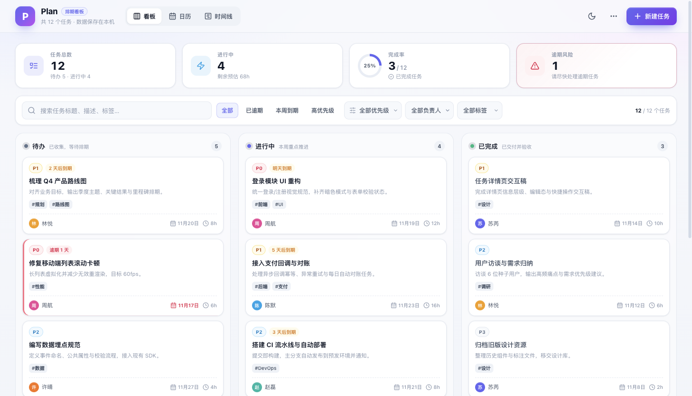
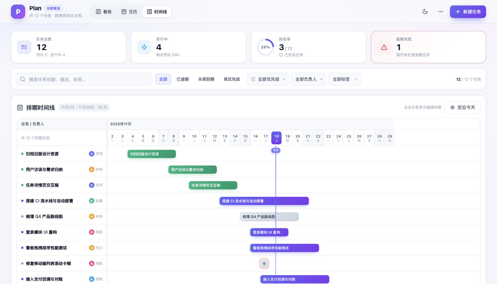

# Plan · 任务排期看板

一个以个人工作排期为核心的任务管理工具。首次进入「今日」可快速记下任务、处理逾期事项、查看当天安排；切到看板管理状态，切到日历或时间线规划后续工作。浏览器会记住上次使用的视图。

在「今日」输入标题后按回车即可记录，截止日期可留空。已完成的事项会离开议程，短时间内可点「撤销」，之后也可在看板中重新打开。GitLab 模式的议程默认只看自己负责的任务，可切换到全部；快速记录会指派给当前用户。

> **在线演示**：https://flywheel1412.github.io/Plan/

## 界面预览

**看板视图** — 拖拽卡片跨列调整状态，逾期任务自动高亮



**日历视图** — 按截止日期铺开任务，点击日期即可快速新建


**时间线视图** — 甘特式任务条展示排期区间与今日位置




## 功能特性

- **四栏看板 + 拖拽**：待办 / 进行中 / 推迟 / 已完成，支持跨列移动与列内排序，拖拽后自动持久化。推迟是未完成状态，不会自动修改原有排期；过期后仍会提醒。
- **完整排期字段**：标题、描述、优先级（P0–P3）、负责人、标签、开始/截止日期、预估工时。
- **日历视图**：按月查看截止任务，逾期任务高亮，点击任意日期即可快速新建任务。
- **时间线视图**：甘特式任务条展示起止区间，自动定位「今天」，按负责人与排期排序。
- **筛选与搜索**：关键词搜索（标题/描述/标签/负责人）、优先级、负责人、标签筛选，以及「已逾期 / 本周到期 / 高优先级」快捷筛选。
- **统计概览**：任务总数、进行中、完成率环形进度、逾期风险与剩余预估工时。
- **本地优先**：数据自动保存在浏览器 `localStorage`，无需后端；支持一键导出 / 导入 JSON 备份。
- **体验细节**：浅色 / 深色主题、响应式布局、快捷键 `N` 新建任务、动效与空状态。
- **键盘可用**：卡片支持 `Space` 拖起、方向键移动、再次 `Space` 放下。

## 技术栈

- [React 18](https://react.dev/) + [Vite 5](https://vitejs.dev/) + TypeScript
- [@dnd-kit](https://dndkit.com/)（拖拽与排序）
- [date-fns](https://date-fns.org/)（日期计算，中文 locale）
- [lucide-react](https://lucide.dev/)（图标）
- 原生 CSS 变量设计系统，无 UI 框架依赖

## 快速开始

```bash
npm install
npm run dev        # 本地开发，默认 http://127.0.0.1:5180
npm run build      # 类型检查 + 生产构建，产物在 dist/
npm run preview    # 预览生产构建
```

构建产物是纯静态文件，可部署到 GitHub Pages、Vercel、Netlify 或任意静态服务器（`vite.config.ts` 已设置 `base: "./"`，支持子路径托管）。

## 部署

仓库已配置 GitHub Actions 自动部署（`.github/workflows/deploy.yml`）：推送到 `master` 分支后自动执行 `npm ci && npm run build`，并通过 `actions/deploy-pages` 发布到 GitHub Pages。

- **线上地址**：https://flywheel1412.github.io/Plan/
- 也可在仓库 **Actions → Deploy to GitHub Pages** 中手动触发（`workflow_dispatch`）。
- 若使用自有域名，可在 **Settings → Pages → Custom domain** 中配置。

### 内网 Gitea 镜像

- 源码镜像：由内网 Gitea 的 `jingxu/plan-kanban` 仓库保存（访问地址见内部文档）。
- 说明：Gitea 1.27.3 不提供内置静态 Pages，且 raw 文件被强制以 `text/plain` + CSP sandbox 返回，无法直接承载 HTML/JS；因此网页托管以 GitHub Pages 为准，Gitea 仅保存源码镜像。
- 更新镜像：在能同时访问 GitHub 与内网 Gitea 的机器上，用 `git clone --mirror` 克隆本仓库并推送到内网镜像仓库。

### 内网 GitLab Pages

- 项目：内网 GitLab 的 `project/plan-kanban`；站点地址见内部文档。
- 构建产物已提交到 `site/`（由 `npm run build` 的 `dist/` 同步而来），`.gitlab-ci.yml` 直接发布该目录，适配没有 Node/npm 的 shell runner。
- 更新站点：重新构建并同步 `site/` 后推送 `master`，GitLab 流水线会自动重新发布。
- Pages 的访问控制、唯一域名与 HTTPS 策略由 GitLab 管理员配置。

## 数据存储

应用支持两种运行模式，由部署目录中是否存在 `config.json` 自动判断：

### 本地模式

- 适用于 GitHub Pages 等纯静态托管（没有 `config.json`）。
- 数据保存在浏览器 `localStorage` 的 `plan-kanban.tasks.v1` 键中，按浏览器/域名隔离。
- 顶部「⋯」菜单可导出 / 导入 JSON，或恢复示例数据。

### GitLab 协作模式

- 适用于内网 GitLab Pages（部署时生成 `config.json`）。
- 通过 GitLab OAuth 2.0（PKCE 公共客户端）登录，任务保存为项目中的 **GitLab Issues**。
- 字段映射：
  - 状态：`status::todo` / `status::doing` / `status::done`；标记为完成时会关闭 Issue。
  - 优先级：`priority::P0` … `priority::P3`。
  - 标签：`tag::<名称>`。
  - 截止日期：Issue 的 `due_date`。
  - 开始日期、预估工时、列内排序、原始负责人姓名：写在 Issue 描述中的隐藏元数据里。
  - 负责人：优先匹配 GitLab 项目成员；未匹配时保留姓名展示，不强制分配。
- `config.json` 由 GitLab CI 根据以下项目变量生成，不提交到仓库：
  - `PLAN_GITLAB_BASE_URL`
  - `PLAN_GITLAB_PROJECT_ID`
  - `PLAN_GITLAB_CLIENT_ID`
  - `PLAN_GITLAB_REDIRECT_URI`
- OAuth 应用需使用公共客户端（不勾选「私密」），回调地址为站点根地址，scope 为 `api`。
- 首次连接空项目时，可一键导入本机任务或创建示例任务；之后所有增删改与拖拽都会写回 GitLab Issues。

## 备份

- 顶部「⋯」菜单可**导出 JSON 备份**，两种模式都可用。
- 本地模式可导入 JSON、恢复示例数据；GitLab 模式的任务本身保存在 Issues 中，空项目可导入本机任务或创建示例任务。
- 导入时仅校验标题与状态，未知字段会被安全忽略。

任务数据结构：

```ts
interface Task {
  id: string;
  title: string;
  description: string;
  status: "todo" | "doing" | "done";
  priority: "P0" | "P1" | "P2" | "P3";
  assignee: string;
  tags: string[];
  startDate: string | null; // YYYY-MM-DD
  dueDate: string | null;   // YYYY-MM-DD
  estimate: number | null;  // 小时
  order: number;
  createdAt: string;
  updatedAt: string;
}
```

## 快捷键

| 按键 | 行为 |
| --- | --- |
| `N` | 新建任务（输入框聚焦时不会触发） |
| `Space` | 聚焦卡片后拖起 / 放下 |
| `↑ ↓ ← →` | 拖动时移动卡片 |
| `Esc` | 关闭弹窗或取消拖拽 |

## 目录结构

```
src/
├─ App.tsx                 # 页面状态、筛选、导入导出
├─ components/
│  ├─ Header.tsx           # 顶部导航与操作菜单
│  ├─ StatsBar.tsx         # 统计概览
│  ├─ FilterBar.tsx        # 搜索与筛选
│  ├─ Board.tsx            # 看板与拖拽上下文
│  ├─ TaskCard.tsx         # 任务卡片
│  ├─ TaskModal.tsx        # 新建 / 编辑弹窗
│  ├─ CalendarView.tsx     # 日历视图
│  └─ TimelineView.tsx     # 时间线视图
├─ hooks/useTasks.ts       # 任务 CRUD、排序与持久化
├─ data/seed.ts            # 示例数据
├─ utils/date.ts           # 日期工具
└─ styles.css              # 设计系统与主题
```

## 说明

本项目为纯前端演示 / 个人或小团队轻量排期工具，数据只存在本机浏览器中，不包含账号体系与服务端同步。若需要多人协作，可在此基础上接入后端 API 或 GitHub Issues。
